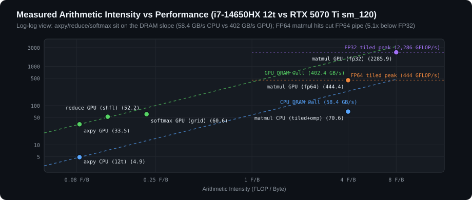
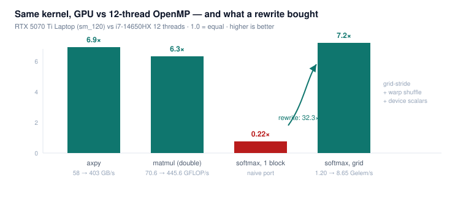

# cuda-omp-roofline

> **Why I wrote this:** Moving from COMSOL/Python to C and CUDA, I got tired of guessing whether
> a slow kernel was memory-bound, launch-bound, or just wrong. So I wrote one small C11 + CUDA
> harness that refuses to print a timing number until it checks `max|diff|` against a CPU reference
> on non-zero data—and plots where every kernel lands on the CPU and RTX 5070 Ti roofline.



## What is inside

| kernel | CPU variants | GPU variants (`sm_120`) | what it exposes |
| --- | --- | --- | --- |
| `axpy` (`y += a*x`) | `ref`, `omp` | `k_axpy` | memory-bus wall: 58.35 GB/s CPU vs 402.40 GB/s GPU (6.9×) |
| `reduce` (sum) | — | warp-shuffle (`__shfl_down_sync`) two-stage | reduction throughput near device DRAM limit (417.9 GB/s) |
| `softmax` | `ref`, `omp` | 1-block naive vs grid-stride + device scalars | why a naive GPU port loses 4.5× to CPU, and gains **32.3×** on rewrite |
| `matmul` (`C=A*B`) | `naive`, `tiled 64`, `tiled+omp` | 32×32 shared-memory tiled (`fp32` & `fp64`) | cache blocking (~7×) + OpenMP (4.4×) + consumer FP64 cut (5.1×) |

## CPU Results: CI (`4 vCPU`) vs Laptop (`i7-14650HX`, 12 threads)


Best and median of 5 timed runs after one untimed warmup. Two separate GitHub Actions `ubuntu-latest`
runs (`Intel Xeon Platinum 8573C, 4 vCPU, gcc 15.2.0`) are shown alongside my laptop (`gcc 16.2.0`)
because the variance between shared CI runners is part of the lesson:

| kernel | variant | CI Run A (4 vCPU) | CI Run B (4 vCPU) | CI spread A / B | Laptop 12t | Laptop spread |
| --- | --- | --- | --- | --- | --- | --- |
| `axpy` | `ref` | 21.45 GB/s | 62.77 GB/s | 0.30% / 0.98% | 31.94 GB/s | 9.82% |
| `axpy` | `omp` | 40.22 GB/s | 72.96 GB/s | 0.09% / **47.17%** | **58.35 GB/s** | 5.77% |
| `softmax` | `ref` | 0.19 Gelem/s | 0.28 Gelem/s | 0.57% / 0.50% | 0.26 Gelem/s | 1.33% |
| `softmax` | `omp` | 0.47 Gelem/s | 0.88 Gelem/s | 4.13% / 0.88% | **1.20 Gelem/s** | 12.37% |
| `matmul` | `naive` | 1.15 GFLOP/s | 0.36 GFLOP/s | 0.58% / 0.48% | 2.28 GFLOP/s | 0.51% |
| `matmul` | `tiled 64` | 8.23 GFLOP/s | 12.35 GFLOP/s | 0.29% / 0.16% | 16.05 GFLOP/s | 0.93% |
| `matmul` | `tiled 64 + omp` | 18.41 GFLOP/s | 30.08 GFLOP/s | 0.48% / 0.12% | **70.62 GFLOP/s** | 3.81% |

- **Never quote a speedup whose denominator jitters:** `naive` matmul swung 3× across CI runs (`1.15 → 0.36 GFLOP/s`), turning `tiled` into "7×" or "34×" without changing a line of code.
- **Reject noisy rows (`spread > 20%`):** `axpy omp` in CI Run B had a 47% spread (`5.52 ms` best vs `8.12 ms` median)—shared-runner noise, not kernel behavior.

## GPU Results (`RTX 5070 Ti Laptop, sm_120, CUDA 13.5`)

Every GPU kernel runs on deterministic non-zero inputs and asserts full `max|diff|` against a CPU
reference before reporting milliseconds:

| kernel | CPU 12 threads | GPU | GPU / CPU | max\|diff\| vs CPU |
| --- | --- | --- | --- | --- |
| `axpy` (double, 16.7 M) | 58.35 GB/s | **402.40 GB/s** | 6.9× | `2.22e-16` |
| `reduce` (double, warp shuffle) | — | **417.9 GB/s** | — | `7.45e-16` |
| `matmul` (double, n=512 tiled) | 70.62 GFLOP/s | **444.42 GFLOP/s** | 6.3× | `7.82e-14` |
| `matmul` (float, n=512 tiled) | — | **2,285.91 GFLOP/s** | — | `2.08e-04` |
| `softmax` (double, 1-block naive) | 1.20 Gelem/s | 0.2679 Gelem/s | **0.22×** | `1.19e-18` |
| `softmax` (double, grid-stride + device scalars) | 1.20 Gelem/s | **8.6532 Gelem/s** | **7.2×** | `1.19e-18` |



1. **A naive GPU port can lose 4.5× to 12 CPU threads—and then gain 32.3×.** One block of 1024 threads
   walked 1 M elements serially (`0.2679 Gelem/s`). Rewriting as grid-stride with `__shfl_down_sync`
   and device-resident scalars hit `8.6532 Gelem/s` (`7.2×` CPU).
2. **Consumer FP64 is cut:** `matmul` drops `5.1×` from float (`2,286 GFLOP/s`) to double (`444 GFLOP/s`).
3. **Bandwidth ceilings align across projects:** `axpy` hits `58.35 GB/s` (CPU) and `402.4 GB/s` (GPU)—the
   same memory walls hit by CSR SpMV in [fem-diffusion-cuda](https://github.com/cccjj55/fem-diffusion-cuda)
   and 2D Jacobi in [jacobi-halo-mpi](https://github.com/cccjj55/jacobi-halo-mpi).

## Build and run

```bash
make build      # gcc -O3 -march=native -fopenmp
make test       # CPU correctness check (aborts on mismatch)
make bench      # CPU sweep -> results/bench.csv
make gpu-bench  # nvcc -O3 -arch=sm_120 + CPU verification
```

## License

MIT
