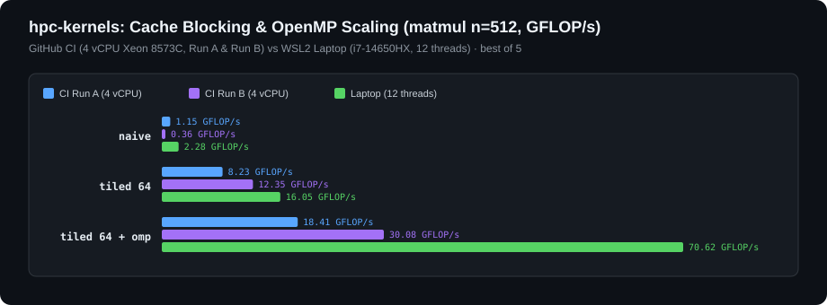

# hpc-kernels

Three kernels, each written three ways, measured by one harness that refuses to time a wrong answer.

This is the first rung of the HPC ladder: before touching CUDA or MPI, know what the CPU is doing.
Every optimized variant is diffed against a reference implementation *before* it is timed, so a fast
wrong answer cannot make it into the table.



## What is in here

| kernel | variants | what it teaches |
| --- | --- | --- |
| `axpy` (`y += a*x`) | `ref`, `omp` | memory bandwidth: 3 streams per element, arithmetic is free |
| `softmax` | `ref`, `omp` (max-reduction + sum-reduction) | compute-bound (exp) plus a reduction that has to stay numerically stable |
| `matmul` (`C=A*B`) | `naive`, `tiled` (64×64), `tiled+omp` | cache blocking and loop order; the naive version is bandwidth-starved by construction |

## Running it

```bash
make build      # gcc -O3 -march=native -fopenmp
make test       # quick run; aborts on any correctness mismatch
make bench      # full run -> results/bench.csv
```

Needs a C11 compiler and OpenMP. No dependencies beyond libm.

## Results

Measured on GitHub Actions `ubuntu-latest` (4 vCPU), not on my laptop — the runner is the one machine
whose hardware I can state exactly and that anyone can re-create.

<!-- RESULTS:BEGIN -->
Measured in CI on GitHub Actions `ubuntu-latest`: **Intel Xeon Platinum 8573C, 4 vCPU, gcc 15.2.0**,
`-O3 -march=native -fopenmp`, 4 threads. Sizes: axpy 16.7 M doubles, softmax 4.2 M doubles, matmul n=512.
Best and median of 5 timed runs after one untimed warmup. Two separate CI runs are shown because the
difference between them is the most useful thing on this page.

| kernel | variant | run A (metric) | run B (metric) | run A spread | run B spread |
| --- | --- | --- | --- | --- | --- |
| axpy | ref | 21.45 GB/s | 62.77 GB/s | 0.30% | 0.98% |
| axpy | omp | 40.22 GB/s | 72.96 GB/s | 0.09% | **47.17%** |
| softmax | ref | 0.19 Gelem/s | 0.28 Gelem/s | 0.57% | 0.50% |
| softmax | omp | 0.47 Gelem/s | 0.88 Gelem/s | 4.13% | 0.88% |
| matmul | naive | 1.15 GFLOP/s | 0.36 GFLOP/s | 0.58% | 0.48% |
| matmul | tiled 64 | 8.23 GFLOP/s | 12.35 GFLOP/s | 0.29% | 0.16% |
| matmul | tiled 64 + omp | 18.41 GFLOP/s | 30.08 GFLOP/s | 0.48% | 0.12% |

Correctness at these sizes: `max|diff|` = 0 for axpy and matmul, 4.7e-20 for softmax (different reduction
order; that residue is expected, not a bug).

**Run C: this laptop, not a runner.** WSL2 Ubuntu 24.04, `i7-14650HX`, 12 threads visible to OpenMP,
gcc 16.2.0 (conda-forge). Same binary, same sizes:

| kernel | variant | metric | spread |
| --- | --- | --- | --- |
| axpy | ref | 31.94 GB/s | 9.82% |
| axpy | omp | **58.35 GB/s** | 5.77% |
| softmax | ref | 0.26 Gelem/s | 1.33% |
| softmax | omp | **1.20 Gelem/s** | 12.37% |
| matmul | naive | 2.28 GFLOP/s | 0.51% |
| matmul | tiled 64 | 16.05 GFLOP/s | 0.93% |
| matmul | tiled 64 + omp | **70.62 GFLOP/s** | 3.81% |

Same conclusions, different absolute numbers: blocking gives ~7×, threads on top give another 4.4× here versus
2.2× on the 4-vCPU runner. **Twelve cores change the ratio, not the ranking** — which is the reason every row
carries a hardware line.

**What is stable across runs and what is not**

- **Stable: tiled → tiled+omp is about 2.2–2.4×.** Both runs agree. Threads on top of blocking is a real,
  repeatable gain.
- **Stable: softmax with threads is 2.5–3.1×.** The work is compute-bound, so scaling survives the shared
  machine.
- **Not stable: everything measured against `naive`.** Blocking looks like 7× in run A and 34× in run B —
  not because blocking changed, but because the naive baseline moved by 3× (1.15 → 0.36 GFLOP/s). A speedup
  whose denominator is noisy is not a speedup you can quote.
- **Not quotable: `axpy omp` in run B (47% spread).** The best sample was 5.52 ms and the median 8.12 ms:
  that row says "the runner was busy", nothing about the kernel.

**The quick run is worse, on purpose.** At n = 1.05 M the same OpenMP `axpy` measured 78.4 GB/s in one run and
5.1 GB/s in the next, and threaded `softmax` came out 10× *slower* than the reference. At that size the array
fits in cache and thread spin-up dominates. The quick run exists to check correctness, never to produce a number.

This is why the repo reports best, median and spread instead of a single figure: on a shared runner, a lone
number is mostly a description of the runner.
<!-- RESULTS:END -->

## What the numbers mean

- **`axpy` is a bandwidth test, not a compute test.** 3 × 8 bytes per element, so the GB/s figure is the
  ceiling everything else has to live under. OpenMP helps only until the memory bus saturates; past that
  more threads make the number worse, not better.
- **`softmax` is compute-bound** because of `exp`, but the max-reduction and the sum are the parts that
  decide whether it is numerically stable. The OpenMP version keeps both reductions explicit; a version
  that fuses them looks faster and drifts on wide input ranges.
- **`matmul` naive is 3 nested loops in the wrong order.** For `n=512` the inner loop walks `B` by columns,
  touching a new cache line per iteration. Blocking fixes locality; OpenMP then has something worth
  parallelising. If you parallelise the naive version first, you scale a memory stall.

## Timer discipline

- one untimed warmup per variant (page faults, cold caches, frequency ramp)
- 5 timed repeats, report **best and median plus spread**, not a single number
- the correctness check runs before the timing, every time

The same rules as [dsh-plugin-bench](https://github.com/cccjj55/dsh-plugin-bench), applied to C.

## The same kernels on the GPU

`make cuda` builds `src/kernels_cuda.cu`. Sizes match the CPU run: axpy 16.7 M doubles, softmax 1.05 M
doubles, matmul n=512. Device: **RTX 5070 Ti Laptop, sm_120, CUDA 13.5**; CPU rows are the 12-thread
OpenMP numbers from above (i7-14650HX).

| kernel | CPU 12 threads | GPU | GPU/CPU |
| --- | --- | --- | --- |
| axpy (double) | 58.35 GB/s | **402.75 GB/s** | 6.9× |
| reduce (sum, double) | — | 418.9 GB/s | — |
| matmul (double, tiled) | 70.62 GFLOP/s | **445.56 GFLOP/s** | 6.3× |
| matmul (float, tiled) | — (not implemented) | 2,281.56 GFLOP/s | — |
| softmax (double, one block) | 1.20 Gelem/s | **0.26 Gelem/s** | **0.22×** |


Three things this table says that a "GPU is faster" claim does not:

1. **A naive port can be 4.5× slower than 12 CPU threads.** The softmax kernel is one block of 1024
   threads sweeping 1 M elements — every thread walks 1024 values serially. It is correct and it is
   terrible. The fix is a grid-stride multi-block version with a two-stage max/sum reduction, which is
   the next commit, not a bigger GPU.
2. **FP64 is cut on consumer silicon.** The same tiled matmul runs at 2,281 GFLOP/s in float and
   445 GFLOP/s in double — a 5.1× ratio that comes from the hardware's FP64 pipe, not from the code.
   Numerical work that needs double precision gets a much smaller win than the marketing numbers suggest.
3. **Bandwidth-bound kernels are where the GPU genuinely wins.** axpy moves 3 × 8 bytes per element and
   runs 6.9× faster than the 12-thread CPU version, close to the device's measured copy bandwidth
   (392.3 GB/s) — the same wall the SpMV in [cae-parallel-solver](https://github.com/cccjj55/cae-parallel-solver)
   hits.

Measurement discipline is unchanged: 5 warmup launches, then 10–20 timed launches, and the number
quoted is the mean of the timed batch (not a single launch). On a laptop GPU the sustained number is
lower than the burst number — see the sustained-bandwidth table in the solver repo.

## Status and what comes next

- [x] CPU reference + OpenMP + blocking, correctness-checked
- [x] CUDA: `axpy`, `reduce`, `softmax` (currently one block), `tiled matmul` in float and double
- [ ] MPI: 2D stencil with halo exchange, strong and weak scaling curves (`mpi-heat`)
- [ ] multi-block softmax (the one-block version is 4.5× slower than the CPU)
- [ ] roofline plot: put every kernel on the same arithmetic-intensity axis

The CUDA step needs a GPU; this laptop has one (RTX 5070 Ti Laptop, 12 GB, sm_120) but no CUDA toolkit
in WSL yet. Numbers will be added with the hardware line attached, not before.

## License

MIT
